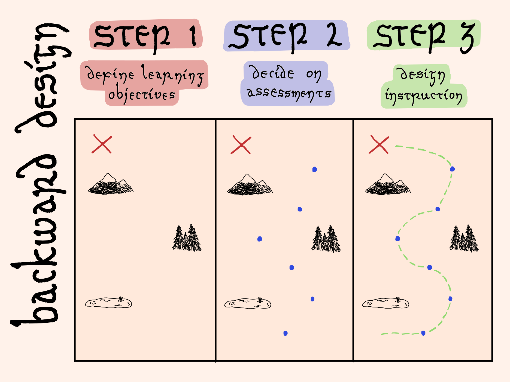

## Explore

### Step 1: Refresh

> [!question] Prompt
> Take at least 3 minutes to record your thoughts to the questions below. You **do not** need to address every question. Instead, focus on the question(s) that you feel most comfortable and confident addressing. Feel free to use any method of recording you prefer (e.g., writing, bullets, audio, drawing, etc.).
> 
> - What are some ways to design a course that you have used and/or heard about?
> - What comes to mind when you think of the term "Backward Design"?
> - Think about a time you started something with the end in mind first. What was that experience like? What was helpful? What was challenging?

Often, when I'm coding for fun, I don't have a specific direction. Instead, I have a vague idea of what I want. This tends to be really difficult, since I don't know what the first step should be.

However, when I take time to figure out what the end product should be, it becomes a lot easier, since I can start asking questions about what I need to do to get there. This helps me to identify concrete steps a lot easier.

For example, if I identify that I would like to build a financial planning app, I can ask a series of questions to identify what my next task should be.
- What do I want it to look like? That depends on what I need the functionality to be.
- What are the steps that I use for financial planning? Well, the first step is to import all of my finances from my bank account.
- What format does my bank provide? CSV.
- How do I parse the CSV? With the `csv` library.
- How do I get the CSV from the user? They can upload it to the page and send it to the server.
- ... etc.

So beginning with the end in mind allows me to figure out what tasks I need to do next.

### Step 3: Reinforce

> [!question] Prompt
> - What are some of the key steps and/or principles of backward design? How can, or have, these be implemented into your teaching?
> - What are ways you may gain insights from your students about how to use backward design?
> - Can you describe a specific example of using backward design in planning a lesson or course? If not, where could you start in implementing this strategy?
> - What questions do you still have about backward design? Who, where, or what are some resources you can access to help to explore these questions?
> - What are ways backward design helps to support student success and inclusivity?
> - How might you measure, understand, and/or evaluate the use of backward design within your course?

_Beginning with the end in mind_ is a key principle of backwards design. When you start your plans with where you want to end up, it's a lot easier to identify what steps you need to take to get there. You simply keep walking backwards until you get there.

I think it's interesting that the end starts out as an "unmeasured" learning objective, which is then made "measurable" by defining what assessments will be used as evidence that the learning objective is met. This step is important, since we can't improve our teaching or help the student if we don't have any indication that they aren't meeting the learning objective, or more importantly, _why_ they aren't meeting the learning objective.

Backwards design seems to be very beneficial for students. Everything that they do is connected back to a bigger idea, rather than just being an isolated blob of information. When students are able to connect an idea with other concepts that they understand, it makes it a lot easier to understand and internalize that idea.

And I think backwards design makes curriculum design a lot less intimidating for me, too. If I'm teaching a class on "algorithms", that's a very general topic, and I could go a lot of different ways from there. Identifying the learning objectives, then the assessments, then the instructional methods helps me to feel a lot more confident that what I'm teaching is actually valuable to the students.

## Engage

I designed a visual model for the steps of backwards design. The model treats the process of curriculum design as a map-building process.

## Reflect

> [!question] Prompt
> Take a moment to articulate a short summary of your beliefs about teaching and learning. After you have done one round of articulation, review your summary and make any revisions you like. Then, think about and respond to the questions below:
> 
> - What aspects of backward design align with your current beliefs about teaching and learning? (LO3)
> - To what extent do you see alignment between your goals, methods, and assessment strategies? In what way might backward design help you refine this alignment? (LO1)
> - In what ways might aspects of backward design be helpful to support learning for students from the variety of background you teach? (LO5)

### My beliefs about teaching

Teaching isn't about the assignments or about the assessments, it's about the people. When you focus on serving those that you teach, both you and the students will enjoy the class more. The goal of teaching is to help the students feel empowered so that they can go out and change the world themselves.

### Question responses

I like that backward design, and the overarching concept of _understanding by design_, focus on ensuring that the student understands the concept. It can be easy to get distracted by the large amount of content that _could_ be taught in a course and lose sight of the fact that the students might be overwhelmed by all the content. If you lose sight of the focus of teaching, you'll fall short of helping your students.

In terms of supporting a variety of backgrounds, I hadn't really pondered that up to this moment. However, I think it makes sense that when you are focusing on the learning objectives as your north star, that allows you to adapt your assessments and your instruction to the needs of your students. Some learning activities might be needed for one group of students, but not for another. One set of students might not understand what a for loop is, so you may need an extra lesson about that. Another set of students might be experts at recursion, so you can drop that lesson.

## Further Resources

- [Using Backward Design to Plan Your Course — OSU](https://teaching.resources.osu.edu/teaching-topics/using-backward-design-plan-your)
- [Backward Design Framework — University of California](https://teach.ucmerced.edu/pedagogy-guides/backwards-design)